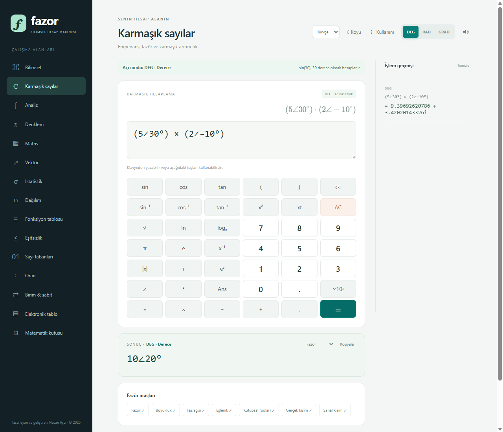

# Fazor

Çevrimdışı bilimsel mühendislik hesap makinesi. Elektrik ve elektronik
mühendisliği çalışmaları, dersler ve sınavlar için tasarlandı.

## İndir

**Releases** bölümünden en yeni `Fazor-Setup-...-x64.exe` dosyasını indirin.

- Kurulum başında Türkçe/İngilizce dil seçimi sunulur; seçilen dilde lisans
  sözleşmesi gösterilir.
- Kurulum; masaüstü ve Başlat menüsü kısayollarını oluşturur.
- Uygulama, Windows **Ayarlar → Uygulamalar → Yüklü uygulamalar** bölümünden
  kaldırılabilir.

## Öne çıkanlar

- Bilimsel ve trigonometrik hesaplamalar; DEG/RAD/GRAD
- `5∠30°` fazör girişi ve fazör sonuç görünümü
- Karmaşık sayılar, matrisler ve vektörler
- İntegral, türev, toplam ve diferansiyel denklem
- İstatistik, olasılık dağılımları, fonksiyon tablosu ve elektronik tablo
- Yirmi kategorili birim çevirici ve bilimsel sabitler
- On beş kategorili Türkçe/İngilizce kullanım kılavuzu
- Ondalık sonuçlar bilimsel üs olmadan, tüm basamaklarıyla gösterilir
- Türkçe/İngilizce arayüz, açık/koyu tema, tamamen çevrimdışı çalışma

## Sistem gereksinimi

64 bit Windows 10/11.

## Güvenlik ve doğrulama

İndirdiğiniz dosyanın SHA-256 özetini, sürüm sayfasındaki `SHA256SUMS.txt` ile
karşılaştırabilirsiniz. Kurucu dijital imzalı olmadığı için Windows SmartScreen
uyarısı gösterebilir ("Daha fazla bilgi" → "Yine de çalıştır").

## Lisans

Fazor kapalı kaynaklı ve tescilli bir yazılımdır; kaynak kodu yayımlanmaz.
Kurulum ve kullanım, birlikte sunulan lisans sözleşmesine tabidir.
Telif hakkı © 2026 Hasan Aşcı. Tüm hakları saklıdır.
